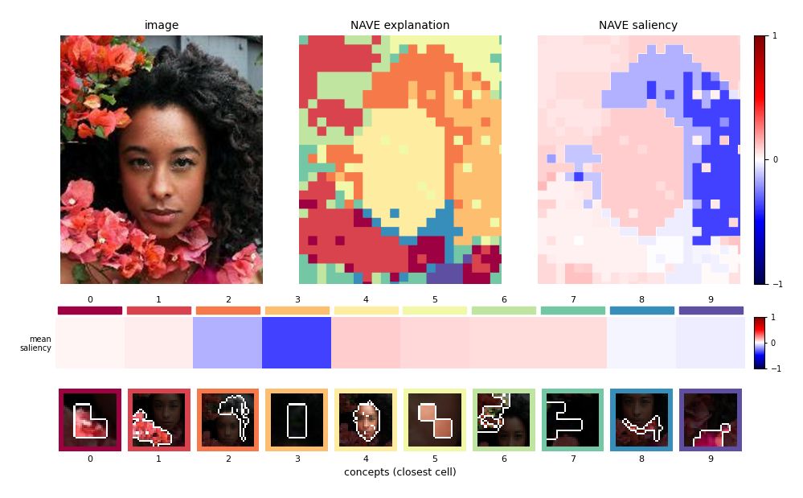

# nave-xai

[](https://pypi.org/project/nave-xai/) [](https://pypi.org/project/nave-xai/) [](https://github.com/Ahcene-B/NAVE/blob/main/LICENSE)

**NAVE explanations of vision encoders: which concepts an encoder extracts, and where.**

`nave-xai` is the official package of **NAVE** (Neuro-Activated Vision Explanations), from
[*Multi-depth Concept Extraction for Post-Hoc Vision Encoder Explanation*](https://doi.org/10.1007/978-3-032-37664-0_26) (ECML PKDD 2026)
by Ahcène Boubekki, Samuel G. Fadel and Sebastian Mair.

NAVE explains the **encoder**, not a prediction. It combines the feature activations of a frozen
encoder at several depths, extracts concepts from them, and returns an explanation map: how the
encoder decomposes the image, before any classifier gets involved. It is post-hoc, unsupervised
and architecture-agnostic (CNNs and ViTs), and needs no fine-tuning.



> **If you use nave-xai in your work, please cite the paper** (see [Citation](#citation)).

## Install

From [PyPI](https://pypi.org/project/nave-xai/):

```bash
pip install nave-xai               # ViT-Ti/16 (ImageNet) weights download on first use, about 11 MB
pip install "nave-xai[torch]"      # explain your own PyTorch models (GPU too)
```

## Explain an image

```python
from nave_xai import NAVEImage

explainer = NAVEImage()                        # ViT-Ti/16, ImageNet weights
exp = explainer.explain(image)            # (H, W, 3) array or PIL image

exp.explanation                           # (H, W) the concept of every pixel
exp.segmentation()                        # (H, W) connected regions, like skimage's slic
exp.border(width=1)                       # (H, W) 0/1 inner margin of every region
```

Draw it with any tool, e.g. matplotlib: `plt.imshow(explainer.palette[exp.explanation])`.
One concept can appear in several places: in a bird image, the scattered background shares one
concept; in a chest X-ray, both lungs do.

## Concepts across a dataset

```python
explainer = NAVEImage(model="resnet50", k=10).fit(images)          # one set of concepts for all images
explanations = explainer.predict(test_images)                  # the same concepts in every image

explainer.prototypes      # (K, D) concept prototypes
explainer.patches         # (K, 2, 32, 32, 3) closest and largest cell of every concept
explainer.classes         # predicted classes (or the groups given to fit)
explainer.correlation     # (K, C) correlation of concept proportions with the classes

explainer.fit(images, groups=labels)            # one projector per group (the paper's protocol)
explainer.reorder(by="classes", recolor=True)   # concepts grouped and coloured by class
explainer.summarize(image, saliency=True)       # a figure in the style of the paper's Figure 1
```

## Time series and text

The same method explains sequence encoders, with one concept per time step or per token:

```python
from nave_xai import NAVESeries, NAVEText

series_explainer = NAVESeries(my_1d_cnn, layers=["block3", "block4", "block5"], k=20).fit(recordings)
series_explainer.summarize(recordings[0])        # channels over the segmentation, snippets, profiles

text_explainer = NAVEText("spacy").fit(documents)  # pip install "nave-xai[text]"
text_explainer.summarize(documents[0])           # tokens on their concept's colour, concept table
```

See [Time series](https://github.com/Ahcene-B/NAVE/blob/main/docs/series.md) and [Text](https://github.com/Ahcene-B/NAVE/blob/main/docs/text.md).

## Choose what to explain

| Model | Trainings | Layers by default |
|---|---|---|
| `"vitt16"` (ViT-Ti/16, default) | random, imagenet | N:12 (last block) |
| `"resnet18"`, `"resnet50"` | random, imagenet (+ dino for ResNet50) | N34 |
| `"vits16"` (ViT-S/16) | random, imagenet, dino | N:12 |

```python
NAVEImage(model="resnet50", layers="N234")          # or layers=[2, 3, 4]
NAVEImage(model="vits16", training="dino", layers="N:9-12")
NAVEImage(projector="bayesian", k=100)              # learns how many concepts are needed
NAVEImage(projector="pca")                          # principal components as concepts
NAVEImage(model="vits16", training="dino", features="keys")   # ViTs: attention keys instead of block outputs
```

Shallow layers carry fine detail and edges, deep layers abstract semantics; NAVE's composite pixels
combine both. Your own PyTorch models, ONNX files and plain functions work too, see
[Your own models](https://github.com/Ahcene-B/NAVE/blob/main/docs/custom-models.md).

## GIMP plugin

[`gimp/`](https://github.com/Ahcene-B/NAVE/tree/main/gimp) holds a GIMP 3 plugin, **Filters › Generic › NAVE Superpixels…**, that adds NAVE's segment
borders, average-coloured segments or concept colours to an image as new layers, with ResNet18, ResNet50 or
ViT-S/16 (random, ImageNet or DINO weights). It runs on its own: no torch, and it sets up a private Python
with numpy and onnxruntime on first use. See [`gimp/README.md`](https://github.com/Ahcene-B/NAVE/blob/main/gimp/README.md) for installation.

## Documentation

- [Getting started](https://github.com/Ahcene-B/NAVE/blob/main/docs/getting-started.md)
- [How NAVE works](https://github.com/Ahcene-B/NAVE/blob/main/docs/concepts.md)
- [Fitting on a dataset](https://github.com/Ahcene-B/NAVE/blob/main/docs/datasets.md)
- [Time series](https://github.com/Ahcene-B/NAVE/blob/main/docs/series.md)
- [Text](https://github.com/Ahcene-B/NAVE/blob/main/docs/text.md)
- [Inspecting models](https://github.com/Ahcene-B/NAVE/blob/main/docs/inspecting.md)
- [Your own models](https://github.com/Ahcene-B/NAVE/blob/main/docs/custom-models.md)
- [Memory and large images](https://github.com/Ahcene-B/NAVE/blob/main/docs/memory.md)
- [API reference](https://github.com/Ahcene-B/NAVE/blob/main/docs/api.md)
- [Animated demos](https://github.com/Ahcene-B/NAVE/tree/main/notebooks/animations): encoders block by block, models during training, shortcuts, fine-tuning
- [Demo notebook](https://github.com/Ahcene-B/NAVE/blob/main/notebooks/demo.ipynb), [time series](https://github.com/Ahcene-B/NAVE/blob/main/notebooks/series.ipynb), [text](https://github.com/Ahcene-B/NAVE/blob/main/notebooks/text.ipynb)

## Citation

If you use nave-xai, please cite the paper:

> Ahcène Boubekki, Samuel G. Fadel, Sebastian Mair. *Multi-depth Concept Extraction for Post-Hoc Vision Encoder Explanation.* Machine Learning and Knowledge Discovery in Databases (ECML PKDD), Research Track, Springer, 2026, pp. 449–467. https://doi.org/10.1007/978-3-032-37664-0_26

```bibtex
@inproceedings{boubekki2026nave,
  author    = {Boubekki, Ahc{\`e}ne and Fadel, Samuel G. and Mair, Sebastian},
  editor    = {Ceci, Michelangelo and Kocev, Dragi and Monreale, Anna and Vens, Celine and Flach, Peter
               and Manco, Giuseppe and Spiliopoulou, Myra and Masciari, Elio},
  title     = {Multi-depth Concept Extraction for Post-Hoc Vision Encoder Explanation},
  booktitle = {Machine Learning and Knowledge Discovery in Databases. Research Track},
  publisher = {Springer Nature Switzerland},
  address   = {Cham},
  pages     = {449--467},
  year      = {2026},
  doi       = {10.1007/978-3-032-37664-0_26},
  isbn      = {978-3-032-37664-0}
}
```

Some features go beyond the paper:
- overlapping windows for large images;
- Bayesian k-means;
- the uncertainty map;
- the saliency procedure.

Results with them are not those reported in the paper.

## Acknowledgments

We thank Ulf Brefeld (Leuphana University Lüneburg) for lending us the computing resources without which this work would not have been possible.

## Weights and licenses

nave-xai is released under the MIT license (see `LICENSE`). Pretrained weights keep their own
licenses:

- ViT-Ti/16 and ViT-S/16 ImageNet: Touvron et al., *Training data-efficient image
  transformers* (DeiT, Apache-2.0), via timm
- ResNet18 / ResNet50 ImageNet: torchvision (BSD-3-Clause), via timm on Hugging Face
- DINO ResNet50 and ViT-S/16: Caron et al., *Emerging Properties in Self-Supervised Vision
  Transformers* (Apache-2.0)

Dependencies: numpy (BSD-3-Clause), onnxruntime (MIT), matplotlib (matplotlib license, BSD-style).
